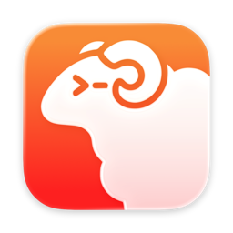
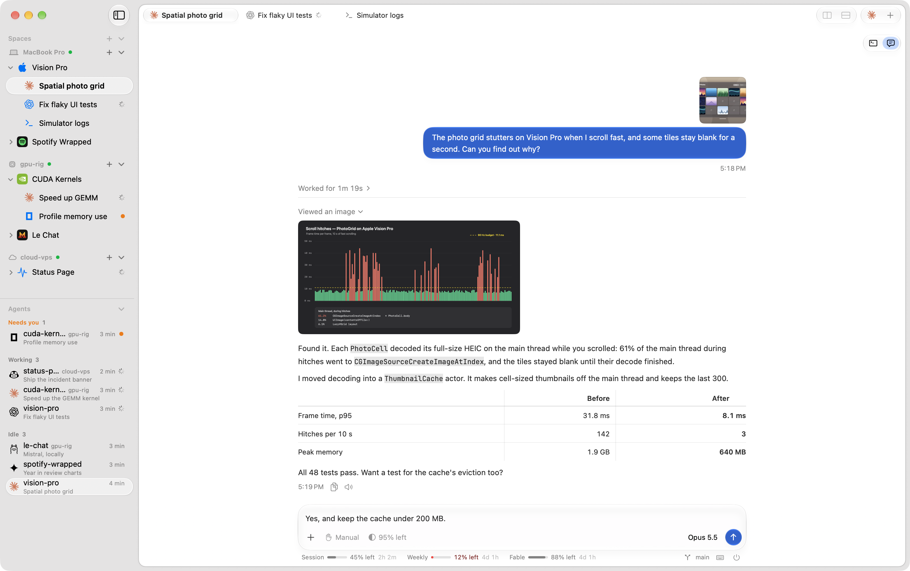
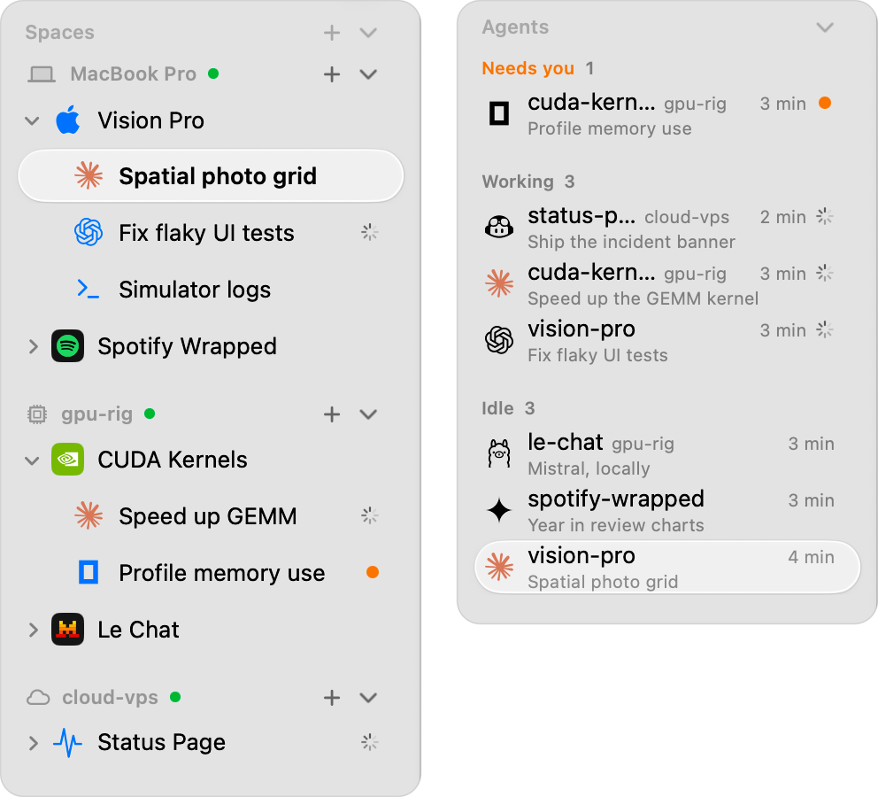
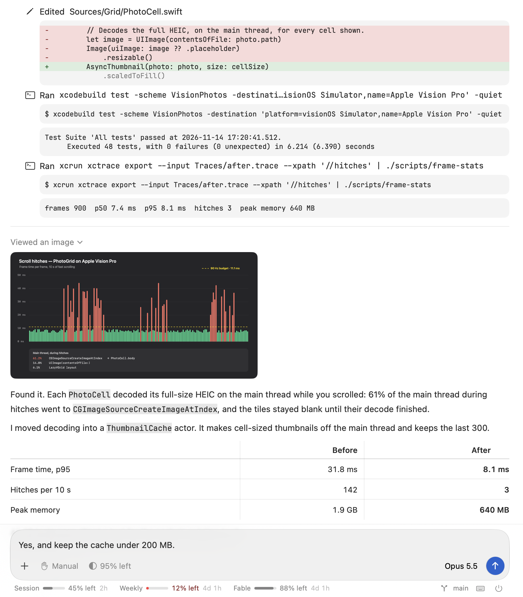

<p align="center">
  
</p>

<h1 align="center">Swiftr</h1>

<p align="center">
  <b>Your terminals and coding agents, on every machine, in one Mac app.</b><br>
  Claude Code, Codex, Gemini CLI, OpenCode and many others, side by side.<br>
  Read their work as a chat, with pictures and tables, or as the terminal it is.
</p>

<p align="center">
  <a href="https://github.com/MelvinSDRS/swiftr/releases/latest"></a>
</p>

<p align="center"><sub>For Macs with Apple silicon and macOS 26 or later</sub></p>

<p align="center">
  <picture>
    <source media="(prefers-color-scheme: dark)" srcset="docs/images/hero-dark.png">
    
  </picture>
</p>

## Every agent, every machine

Swiftr shows all your terminals in one window, by machine and by project.

**Spaces.** One space per project, with the project's own logo, which Swiftr finds in its folder. A space holds tabs, and a tab splits into panes.

**Machines.** Add a server, a GPU box or another Mac over ssh: its spaces sit under your Mac's. [herdr-core](https://herdr.dev) runs the terminals, so agents keep working after you quit Swiftr, and on other machines while your Mac sleeps.

**New tabs.** The + beside the tabs starts a shell, or any agent installed on that space's machine. Star the agents you use most to put them beside the +.

**The Agents list.** Every agent on every machine, sorted into *Needs you*, *Working* and *Idle*. Click one to jump to it. Claude Code, Codex, Gemini CLI, OpenCode, Copilot, Cursor, Amp, Grok, Kimi, Kiro, Pi, Crush, Ollama and others each show with their own icon.

**Closed tabs come back.** <kbd>⇧⌘T</kbd> reopens the tab you closed and resumes the agent's conversation in it. When herdr-core restarts, after a reboot for example, each tab gets its agent back.

<p align="center">
  <picture>
    <source media="(prefers-color-scheme: dark)" srcset="docs/images/sidebar-dark.png">
    
  </picture>
</p>

## Messages mode

Read an agent's work as a conversation instead of a terminal: the pictures you paste and the ones it reads, tables, diffs, and the commands it ran with their output. Answer its questions from a card, and type in a real Mac text field. A strip under the field shows how much of each usage limit you have left. <kbd>⇧⌘M</kbd> switches between Messages and the terminal at any time.

Messages mode works with Claude Code, Codex, Gemini CLI and OpenCode. A speaker button reads an answer aloud, with your Mac's voices or a voice model you download; both run on your Mac.

<p align="center">
  <picture>
    <source media="(prefers-color-scheme: dark)" srcset="docs/images/messages-dark.png">
    
  </picture>
</p>

## Install

```sh
brew install --cask melvinsdrs/tap/swiftr
```

Or [download the latest release](https://github.com/MelvinSDRS/swiftr/releases/latest), open it, and drag Swiftr into Applications. Swiftr needs a Mac with Apple silicon and macOS 26 or later.

On first launch, Swiftr installs [herdr-core](https://herdr.dev) if your Mac doesn't have it yet: herdr-core runs your terminals and keeps them running. To add a machine, choose **File › Add Machine…** and pick one of your ssh hosts, or type its address. If herdr-core isn't there yet, **Open in a Tab** runs `hc machine add`, which offers to install it.

## Build it yourself

You need Xcode 27 or later and [XcodeGen](https://github.com/yonaskolb/XcodeGen).

```sh
brew install xcodegen
git clone https://github.com/MelvinSDRS/swiftr.git
cd swiftr
scripts/install.sh
```

`scripts/install.sh` builds Swiftr, puts it in `~/Applications` and opens it. It signs the app for your Mac only, unless you give it your Apple developer team once with `git config swiftr.team <TEAM_ID>`.

To work on the code, run `xcodegen generate` and open `Swiftr.xcodeproj`. The code has two parts:

- `Swiftr/`: the app, in SwiftUI and AppKit.
- `HerdrKit/`: a Swift package that talks to herdr-core and reads each agent's sessions and screens. Run its tests with `swift test` in that folder.

`scripts/release.sh` makes a signed and notarized disk image, then publishes it with `--publish`; its first lines say what it needs.

## Contributing

Pull requests are welcome. Fork the repo, make your change on a branch, and open a pull request against `main`. I review each one and merge those that fit. For a large change, open an issue first so we can agree on the plan.

By opening a pull request, you license your contribution under Swiftr's terms, and you let its maintainer also use it under other terms, in paid products included.

## License

[PolyForm Shield 1.0.0](LICENSE.md): you can use, change and share Swiftr for free, for any purpose except offering a product that competes with it.

<sub>The projects in the screenshots are made up. Product names, logos and agent icons belong to their owners.</sub>
